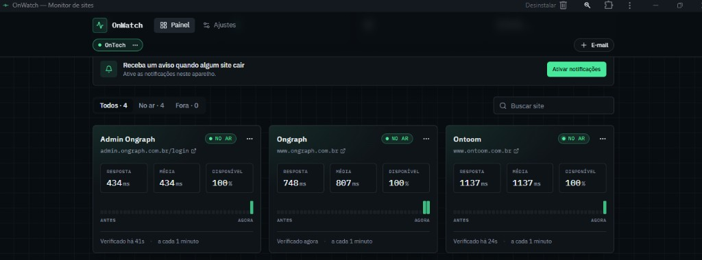
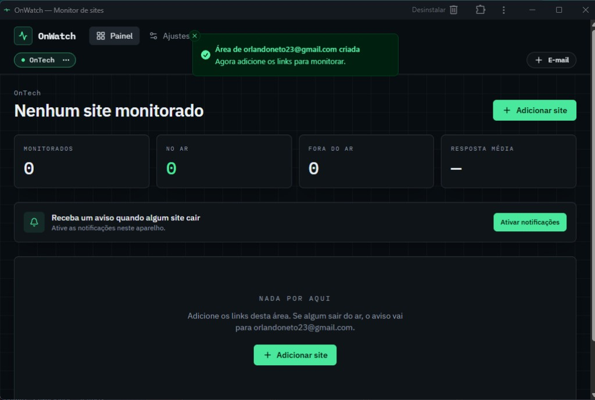
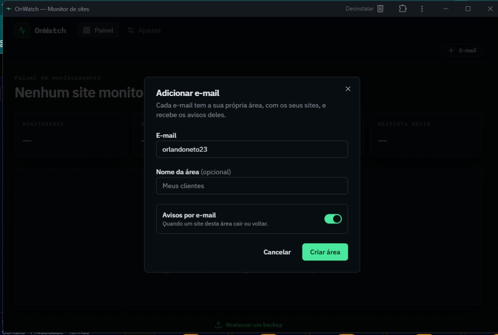
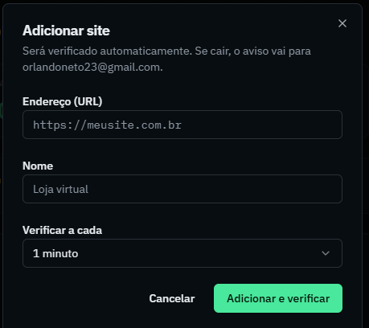

# OnWatch — Monitor de sites

Painel PWA para monitorar se seus sites estão no ar. Sem backend: tudo roda no navegador (ou no app instalado). Áreas separadas por e-mail; avisos por notificação e, opcionalmente, por e-mail (EmailJS).

**App ao vivo:** https://pulse-porch-uptime-watch.orlandoneto.workers.dev

**Repositório:** https://github.com/orlandoneto/pulse-porch-uptime-watch

## Telas

| Painel com sites | Área vazia |
| --- | --- |
|  |  |

| Adicionar e-mail | Adicionar site |
| --- | --- |
|  |  |

## O que faz

- Adiciona URLs e verifica de tempos em tempos (ex.: a cada 1 minuto)
- Mostra status (no ar / fora do ar), latência e disponibilidade
- Áreas por e-mail: cada perfil só vê os próprios sites
- Notificações no aparelho quando um site cai ou volta
- Avisos por e-mail via [EmailJS](https://www.emailjs.com) (opcional, free tier)
- Instala como app (PWA) no celular e no desktop

## Instalar como app

### Android (Chrome)

1. Abra o [app ao vivo](https://pulse-porch-uptime-watch.orlandoneto.workers.dev) no Chrome  
2. Menu **⋮** → **Instalar app** (ou **Adicionar à tela inicial**)  
3. Ou use o banner **Instalar** / a seção em **Ajustes**

### iPhone (Safari)

1. Abra o link no **Safari** (não no Chrome)  
2. **Compartilhar** → **Adicionar à Tela de Início** → **Adicionar**

### Desktop (Chrome / Edge)

Menu do navegador → **Instalar OnWatch** / ícone de instalação na barra de endereço.

## Uso rápido

1. Crie uma área com seu e-mail (**+ E-mail**)  
2. **Adicionar site** com a URL e o intervalo de verificação  
3. Em **Ajustes**, ative notificações (e configure EmailJS se quiser e-mail)

## Uso / Cotas (`/uso`)

Tela para acompanhar as cotas **free** antes de estourar:

- **Cloudflare Workers**: 100.000 requests/dia somando todos os Workers (reset 00:00 UTC), com breakdown por Worker.
- **Vercel Hobby**: Fast Origin Transfer, Fast Data Transfer, CDN requests, ISR writes, storage, Fluid Active CPU e invocations (janela de 30 dias), além de projetos e deploys.
- **Render**: serviços e ping da API VenomID; horas/bandwidth do free tier não são publicados pela API.
- **Checagens HTTP** feitas pelo servidor, com status real (o apex `ongraph.com.br` precisa dar **301**).

Limiares: **< 70%** ok, **>= 70%** atenção, **>= 90%** crítico.

> O uptime de sites continua **somente no cliente** (`localStorage` + `no-cors`). Este módulo é a exceção documentada: ele precisa de servidor porque tokens não podem ir para o navegador e o `no-cors` não enxerga 200/301. Os tokens ficam apenas em `.dev.vars` local ou em secrets do Worker.

### Rodar local

```sh
cd C:\projetos\pulse-porch-uptime-watch
npm i
copy .dev.vars.example .dev.vars   # PowerShell: Copy-Item
# cole os tokens no .dev.vars (ele é gitignored)
npm run dev
# abra http://localhost:8080/uso
```

Variáveis (nomes e escopos; valores nunca vão para o repositório):

| Variável | Escopo |
| --- | --- |
| `CLOUDFLARE_API_TOKEN` | somente leitura — Account Analytics: Read |
| `CLOUDFLARE_ACCOUNT_ID` | id da conta (já vem preenchido no exemplo) |
| `VERCEL_TOKEN` | somente leitura — time `orlandonetos-projects` |
| `VERCEL_TEAM_ID` | id do time (já vem preenchido no exemplo) |
| `RENDER_API_KEY` | opcional, somente leitura |
| `USAGE_DASHBOARD_KEY` | opcional; se definido, `GET /api/usage` exige o header `x-usage-key` |

A API fica em `GET /api/usage` e devolve o JSON agregado. A tela usa uma server function com cache curto (15 s) para não gastar a cota do próprio Worker.

**Nenhum deploy é feito por este módulo.** O cron futuro é só um esboço; a consulta ao vivo no carregamento da página basta no v1.

## Desenvolvimento local

Node.js 20+ e npm:

```sh
git clone git@github.com:orlandoneto/pulse-porch-uptime-watch.git
cd pulse-porch-uptime-watch
npm i
npm run dev
```

Outros scripts:

| Comando | Função |
|--------|--------|
| `npm run build` | Build de produção |
| `npm test` | Testes (Vitest) |
| `npm run cf:build` | Build para Cloudflare Workers |
| `npm run cf:deploy` | Deploy no Worker (após o build) |

## Deploy (Cloudflare)

```sh
npm run cf:build
# ajustar o name em .output/server/wrangler.json se necessário
npx wrangler deploy --config .output/server/wrangler.json
```

Worker publicado: `pulse-porch-uptime-watch` na conta Cloudflare do `orlandoneto`.

## Stack

- Vite + TanStack Start / React  
- Cloudflare Workers (Nitro)  
- PWA (`manifest.webmanifest` + service worker `notify-sw.js`)  
- Estado e checagens no cliente (localStorage)

## Licença

Uso privado / interno da ON Tech, salvo indicação contrária no repositório.
